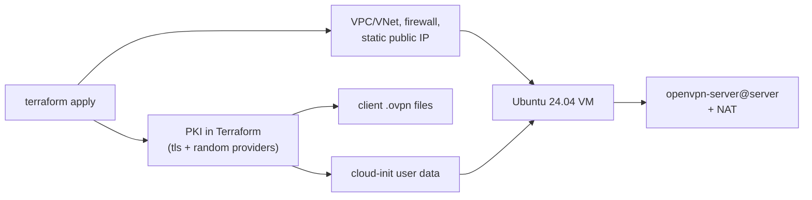

# TerraformOpenVPN

[](https://github.com/gudlyf/TerraformOpenVPN/actions/workflows/ci.yml)
[](LICENSE)

Terraform that stands up a personal OpenVPN server on AWS, Azure or Google Cloud with one `terraform apply`, and hands you ready-to-import `.ovpn` client profiles.

I wrote the first version of this years ago, and it rotted the way untouched infrastructure code does: Ubuntu 16.04, a `template` provider that won't even install on Apple Silicon, and easy-rsa scripts that quietly stopped working. This is a ground-up rewrite for current Terraform, OpenTofu, Ubuntu 24.04 and OpenVPN 2.6. If you used the old one, read [Upgrading from the old version](#upgrading-from-the-old-version) first.

## How it works



- Terraform generates the CA, server and client certificates (ECDSA P-256) and the `tls-crypt` key. Nothing PKI-related runs on the server, so there's no easy-rsa and no `cert_details` file.
- The server gets a static public IP (Elastic IP, Azure Standard static IP or GCP static address). Each client profile is rendered locally with that IP and written to `client_configs/`.
- Everything the server needs ships in cloud-init: OpenVPN from the Ubuntu archive, the certificates, a small NAT service and IP forwarding. No SSH provisioners, no `scp`, no waiting on the instance during `apply`.
- SSH is optional and off by default. When you enable it, fail2ban guards it.

```
.
├── AWS/ Azure/ GCP/        # ready-to-run root configurations (cd in and apply)
├── AzureMktPlace/          # OpenVPN Access Server from the Azure Marketplace (separate design)
├── modules/
│   ├── openvpn-config/     # cloud-agnostic: PKI, cloud-init, client profiles
│   ├── aws/ azure/ gcp/    # reusable per-cloud modules
├── tests/integration/      # Docker end-to-end test (real OpenVPN handshake)
├── client_configs/         # generated .ovpn files land here (git-ignored)
└── certs/                  # optional SSH key pair (git-ignored)
```

## Requirements

- [Terraform](https://developer.hashicorp.com/terraform/install) 1.6+ or [OpenTofu](https://opentofu.org/docs/intro/install/) 1.6+
- Credentials for the cloud you're using:

| Cloud | Credentials | Notes |
| --- | --- | --- |
| AWS | Any standard method: `aws configure`, `aws sso login`, environment variables | Set `profile` if you don't use the default |
| Azure | `az login` | Set `subscription_id` or export `ARM_SUBSCRIPTION_ID` (azurerm 4+ requires it) |
| GCP | `gcloud auth application-default login` | Set `project`; the Compute Engine API must be enabled |

- An OpenVPN client: [OpenVPN Connect](https://openvpn.net/client/), [Tunnelblick](https://tunnelblick.net/) or `openvpn` 2.5+ on the command line.

## Quick start

Pick a cloud, `cd` into its directory, and apply:

```sh
cd AWS                                   # or Azure, or GCP
cp terraform.tfvars.example terraform.tfvars
$EDITOR terraform.tfvars                 # GCP needs `project`; the rest is optional
terraform init
terraform apply
```

When `apply` finishes, the profiles are already on disk:

```
client_config_files = {
  "client" = "../client_configs/aws-client.ovpn"
}
```

Give the server two to five minutes to finish first boot (package upgrades, OpenVPN install and possibly a reboot), then import the `.ovpn` into your client and connect. Check that it worked with `curl https://checkip.amazonaws.com`, which should print the server's IP.

To tear it all down, run `terraform destroy`. That also deletes the generated `.ovpn` files.

## Configuration

These variables are available in all three root configurations. Each cloud adds a few of its own (region, instance size and so on); see its `variables.tf` and `terraform.tfvars.example`.

| Variable | Default | Description |
| --- | --- | --- |
| `clients` | `["client"]` | One certificate and `.ovpn` per name. Removing a name revokes it. |
| `vpn_allowed_cidrs` | `["0.0.0.0/0"]` | Who can reach the VPN port. Lock it down if your clients have fixed IPs. |
| `ssh_public_key_file` | `null` | Public key to install, e.g. `../certs/ovpn.pub`. |
| `ssh_allowed_cidrs` | `[]` | Who can SSH in. SSH stays closed unless this and a key are set. |
| `vpn_port` / `vpn_protocol` | `1194` / `udp` | `tcp` on `443` gets through some restrictive networks, but it's slower. |
| `vpn_cidr` | `10.8.0.0/24` | Client address pool. Must not overlap networks you're connecting from. |
| `dns_servers` | `["1.1.1.1", "9.9.9.9"]` | DNS pushed to clients. |
| `full_tunnel` | `true` | Send all client traffic through the VPN. |
| `cert_subject` | `{ organization = "TerraformOpenVPN" }` | Certificate subject fields (this replaces the old `cert_details`). |
| `client_config_dir` | `../client_configs` | Where `.ovpn` files go. Set to `null` to keep them only in Terraform outputs. |

Default regions are the ones the original project used: `ca-central-1`, `westus2` and `northamerica-northeast1`. Change `region`/`location` to whatever's close to you.

Restricting access to your current IP looks like this:

```sh
terraform apply \
  -var "ssh_public_key_file=../certs/ovpn.pub" \
  -var "ssh_allowed_cidrs=[\"$(curl -s https://checkip.amazonaws.com)/32\"]"
```

### Adding and revoking clients

Edit `clients` and apply:

```hcl
clients = ["laptop", "phone", "tablet"]
```

The server runs with `ccd-exclusive`, so a client can only connect if the server has a file for it in `/etc/openvpn/server/ccd/`. Removing a name deletes its certificate, its `.ovpn` and its ccd entry, which locks that client out even though its old certificate is still signed by the CA.

Any change to clients or server settings changes the cloud-init data, so Terraform replaces the VM. The public IP stays the same, which means existing profiles keep working. Expect a few minutes of downtime.

To rotate everything (CA included), run `terraform apply -replace=module.openvpn.module.openvpn_config.tls_private_key.ca` and redistribute the new profiles.

## Using it as a module

The per-cloud modules work on their own if you'd rather wire this into an existing configuration:

```hcl
provider "aws" {
  region = "us-east-1"
}

module "vpn" {
  # Pin ref to a tag or commit SHA.
  source = "github.com/gudlyf/TerraformOpenVPN//modules/aws?ref=master"

  clients           = ["laptop", "phone"]
  vpn_allowed_cidrs = ["0.0.0.0/0"]
  client_config_dir = "${path.root}/vpn-profiles"
}

output "vpn_ip" {
  value = module.vpn.public_ip
}
```

`modules/azure` and `modules/gcp` take the same OpenVPN inputs. `modules/openvpn-config` is cloud-agnostic: give it a `server_address` and it returns `user_data` (a `#cloud-config` document) and the client profiles, so you can point it at any Ubuntu 24.04 machine that runs cloud-init. Each module has its own README with the full list of inputs and outputs.

## Security notes

This is built for personal and small-team use, and I'd rather you know the trade-offs up front:

- Private keys live in Terraform state. The CA key, server key and client keys are all generated by Terraform. Keep state somewhere private and encrypted (an S3 bucket with encryption and versioning, Terraform Cloud, Azure Storage and so on), not in a public repo. The `.gitignore` already excludes local state.
- The server key is in the instance's user data. Anyone who can read instance user data (`ec2:DescribeInstanceAttribute`, the Azure VM model, GCE metadata) or run code on the VM can read it. Don't share the cloud account with people you wouldn't hand the VPN to.
- Revocation uses `ccd-exclusive` rather than a CRL, so removing a client takes effect when the replacement VM boots. To invalidate every certificate at once, rotate the CA as described above.
- OpenVPN settings: TLS 1.2 minimum, `tls-crypt` on the control channel, AES-256-GCM / AES-128-GCM / ChaCha20-Poly1305 data ciphers, clients pin the server certificate name, and the daemon drops to `nobody` after start.
- AWS enforces IMDSv2 and encrypts the root volume. GCP uses Shielded VM. SSH is closed everywhere unless you open it.

See [SECURITY.md](SECURITY.md) to report a vulnerability.

## Troubleshooting

If a client can't connect, open SSH to your IP (see above) and check the server:

```sh
cloud-init status --long                      # did first boot finish?
sudo tail -n 50 /var/log/cloud-init-output.log
systemctl status openvpn-server@server openvpn-nat
journalctl -u openvpn-server@server -e
```

Without SSH you can still read the boot log: `aws ec2 get-console-output`, Azure boot diagnostics / serial console, or `gcloud compute instances get-serial-port-output`.

Common causes:

- If you connect but have no internet, your local network probably overlaps `vpn_cidr`. Pick a different range.
- If the TLS handshake never starts, the cloud firewall isn't allowing your IP; check `vpn_allowed_cidrs` and `vpn_protocol`.
- OpenVPN 2.4 and earlier don't understand `data-ciphers` and will refuse the profile. Use 2.5 or newer, or OpenVPN Connect 3.

## Upgrading from the old version

The 2026 rewrite is a clean break. State from the old configurations won't carry over, so:

1. Destroy the old deployment with the old code (`git checkout <old-commit>`, then `terraform destroy`). On GCP with Terraform 0.13+, the old destroy-time provisioner errors out ([#1](https://github.com/gudlyf/TerraformOpenVPN/issues/1)). Delete that `provisioner "local-exec"` block with `when = destroy` and try again, or remove the instance in the console.
2. Check out the new version and run `terraform init -upgrade && terraform apply`.

What changed:

- `cert_details` is gone; use `cert_subject` if you care about certificate fields.
- SSH keys in `certs/` are optional now, and so is SSH itself.
- `terraform.tfvars` is no longer committed; copy `terraform.tfvars.example`.
- GCP uses Application Default Credentials instead of `account.json`.
- Azure restricts access with `vpn_allowed_cidrs` / `ssh_allowed_cidrs` instead of looking up your IP from a geo-IP web service at plan time.

See [CHANGELOG.md](CHANGELOG.md) for the full list.

## OpenVPN Access Server on Azure

[`AzureMktPlace/`](AzureMktPlace/) is a separate option contributed by [dandill-eng](https://github.com/dandill-eng). It deploys the commercial OpenVPN Access Server image from the Azure Marketplace (web admin UI, user management, BYOL licensing) rather than plain community OpenVPN. See its [README](AzureMktPlace/README.md).

## Contributing

Issues and pull requests are welcome. [CONTRIBUTING.md](CONTRIBUTING.md) covers the layout, how to run the tests (most need no cloud account at all) and what I look for in a PR.

## License

[GPL-3.0](LICENSE)
